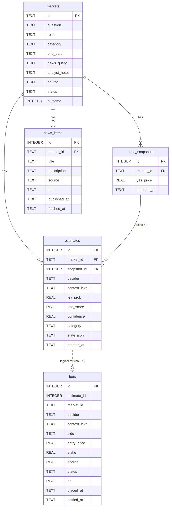

# 04 - Data model (SQLite)

File: `DATA_DIR/edgebook.db`. Plain `sqlite3`, no ORM. All times are **UTC ISO 8601 text** (`2026-09-30T14:00:00Z`).
Money is stored as REAL, rounded to 2 decimals in exactly two places: `size_stake` and `settle_bet`.

## Schema versioning (why and how)

Problem: `CREATE TABLE IF NOT EXISTS` never changes a table that already exists. Once A2 keeps the DB on a persistent volume, adding a column would silently not happen.

`db.init_db()`:
1. Create `DATA_DIR` if missing, open the DB.
2. Read `PRAGMA user_version`.
3. `0` (brand new DB) -> run all `CREATE TABLE` statements, then `PRAGMA user_version = SCHEMA_VERSION`.
4. Equal to `SCHEMA_VERSION` -> do nothing.
5. Anything else -> raise `RuntimeError("DB schema is vN, app expects vM. Delete DATA_DIR/edgebook.db or migrate.")`.

`SCHEMA_VERSION = 1` in `db.py`. During development, if you change a table, bump it and delete `data/`.

## Intel tables

### `markets`
| Column | Type | Notes |
|---|---|---|
| `id` | TEXT PK | Polymarket market id (or fixture id) |
| `question` | TEXT NOT NULL | "Will X happen by Y?" |
| `rules` | TEXT | resolution rules / description |
| `category` | TEXT | from source if available |
| `end_date` | TEXT | when the market closes |
| `news_query` | TEXT | short search query, e.g. `ECB rate cut`. Hand-written in fixture, built by `build_news_query()` otherwise |
| `analyst_notes` | TEXT | optional free-text context from a club analyst |
| `source` | TEXT NOT NULL | `fixture` or `polymarket` |
| `status` | TEXT NOT NULL | `open` or `resolved` |
| `outcome` | INTEGER NULL | 1 = Yes, 0 = No, NULL = not resolved |

### `price_snapshots`
| Column | Type | Notes |
|---|---|---|
| `id` | INTEGER PK AUTOINCREMENT | |
| `market_id` | TEXT NOT NULL, FK -> markets.id | |
| `yes_price` | REAL NOT NULL | 0 to 1 |
| `captured_at` | TEXT NOT NULL | when this price was true. Also the **news cutoff** |
| | UNIQUE(`market_id`, `captured_at`) | re-syncing the same snapshot is a no-op |

### `news_items`
| Column | Type | Notes |
|---|---|---|
| `id` | INTEGER PK AUTOINCREMENT | |
| `market_id` | TEXT NOT NULL, FK -> markets.id | |
| `title` | TEXT NOT NULL | |
| `description` | TEXT | |
| `source` | TEXT | publisher domain |
| `url` | TEXT NOT NULL | |
| `published_at` | TEXT NOT NULL | used by `filter_news_before()` |
| `fetched_at` | TEXT NOT NULL | |
| | UNIQUE(`market_id`, `url`) | cache: never store the same article twice |

### `estimates`
| Column | Type | Notes |
|---|---|---|
| `id` | INTEGER PK AUTOINCREMENT | |
| `market_id` | TEXT NOT NULL, FK -> markets.id | |
| `snapshot_id` | INTEGER NOT NULL, FK -> price_snapshots.id | the exact price Jev is compared against |
| `decider` | TEXT NOT NULL | `stub` or `jev` |
| `context_level` | TEXT NOT NULL | `basic` (no news) or `news` |
| `jev_prob` | REAL NOT NULL | P(Yes), 0 to 1 |
| `info_score` | REAL NOT NULL | 0 to 1 |
| `confidence` | REAL NOT NULL | 0 to 1 |
| `category` | TEXT | Jev's category pick |
| `state_json` | TEXT NOT NULL | exact dict that was rendered and sent to the decider. Audit trail + look-ahead proof. Never contains keys |
| `created_at` | TEXT NOT NULL | |
| | UNIQUE(`market_id`, `snapshot_id`, `decider`, `context_level`) | running twice is a no-op |

## Book table

### `bets`
| Column | Type | Notes |
|---|---|---|
| `id` | INTEGER PK AUTOINCREMENT | |
| `estimate_id` | INTEGER NOT NULL UNIQUE | logical reference, **no FK** across the seam. UNIQUE = one bet per estimate |
| `market_id` | TEXT NOT NULL | logical reference, **no FK** |
| `decider` | TEXT NOT NULL | copied from the Estimate so the scorecard never mixes stub and Jev |
| `context_level` | TEXT NOT NULL | copied from the Estimate |
| `side` | TEXT NOT NULL | `YES` or `NO` |
| `entry_price` | REAL NOT NULL | Yes price, or 1 minus Yes price for No |
| `stake` | REAL NOT NULL | |
| `shares` | REAL NOT NULL | stake / entry_price |
| `status` | TEXT NOT NULL | `open`, `won`, `lost` |
| `pnl` | REAL NULL | set on settlement |
| `placed_at` | TEXT NOT NULL | |
| `settled_at` | TEXT NULL | |

## Idempotency

All inserts that can repeat use `INSERT OR IGNORE` against the UNIQUE constraints above. Double-clicking any button changes nothing the second time.

## Relationships

```
markets 1 --- * price_snapshots
markets 1 --- * news_items
markets 1 --- * estimates
price_snapshots 1 --- * estimates
estimates 1 - - 0..1 bets        (logical only, crosses the domain seam)
```

## Candidate schema decisions for ADR 3 (Javi picks ONE and writes it)

- **A. Separate `price_snapshots` table** instead of a price column on `markets`. You need the price at estimate time to judge edge honestly.
- **B. No foreign keys across the seam.** Intel and Book can move to separate databases in A2.
- **C. Schema versioning with `PRAGMA user_version`** instead of relying on `CREATE TABLE IF NOT EXISTS`. Safe once the DB lives on a persistent volume.
- **D. Store `state_json` on every estimate.** Costs space, but proves what Jev saw and makes look-ahead bias checkable.

Whatever is chosen, `docs/diagrams/db-schema.md` must match it and the real `init_db()` SQL.

## Diagram source (goes in `docs/diagrams/db-schema.md`)


