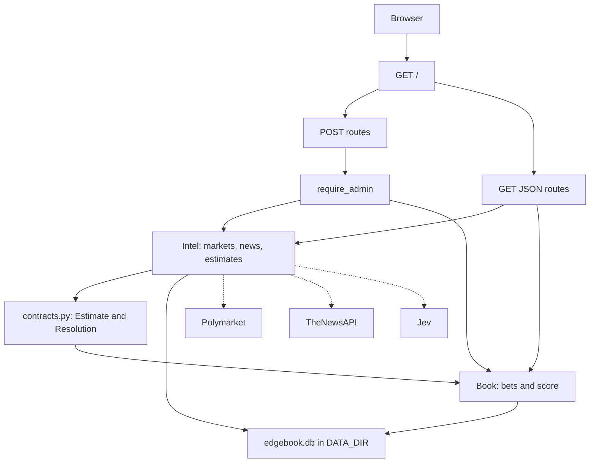

# Architecture

One process. The browser loads `GET /`, and that page only calls the JSON routes. POST routes pass through `require_admin`. GET routes, including `/healthz`, stay open.

Intel fetches markets, headlines, and estimates. Book places paper bets and scores them. `pipeline.py` is the only file that imports both. The only records that cross are `Estimate` and `Resolution` in `contracts.py`. `book/` does not import `intel/`.

Polymarket, TheNewsAPI, and Jev are optional. With no env vars the app uses the fixture and the stub decider. SQLite is one file, `edgebook.db`, inside `DATA_DIR`.

