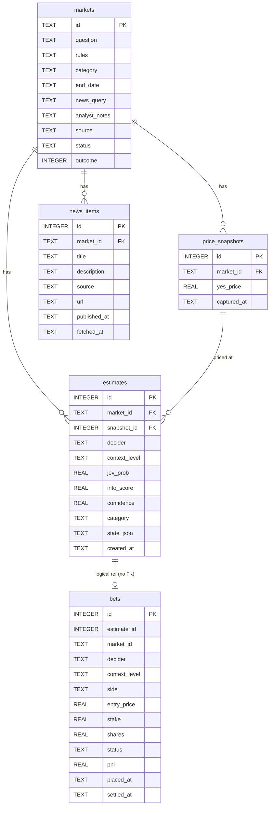

# Database schema

Matches `SCHEMA_SQL` in `db.py`. ADR 3 is about `price_snapshots`: `yes_price` lives there with `captured_at`, and `estimates.snapshot_id` points at that row. `bets` has no foreign key. The dotted line is only a logical link.

`price_snapshots` is unique on `(market_id, captured_at)`. `news_items` is unique on `(market_id, url)`. `estimates` is unique on `(market_id, snapshot_id, decider, context_level)`.

